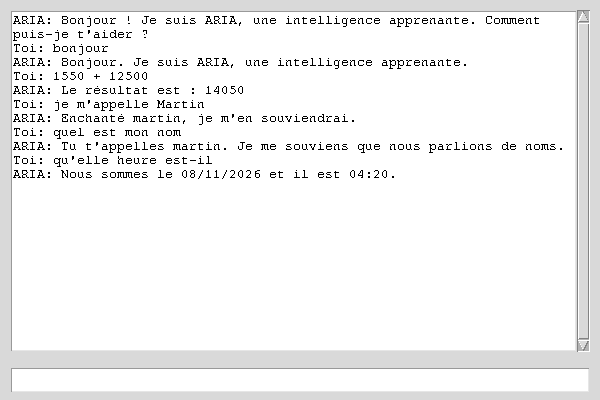

<p align="center">
  
</p>

# ARIA · Intelligence Apprenante Locale

ARIA est une IA **symbolique et adaptative** · version **1.2.0** : un
catalogue déclaratif de compétences, un routeur d'intents à preuve, un
moteur de règles, une mémoire disciplinée et un auto-audit de sécurité ·
aucun LLM, aucun modèle d'apprentissage automatique, aucun cloud. Elle
apprend exclusivement des conversations que vous avez avec elle et
fonctionne **100 % sur votre machine**.

[](https://github.com/Mr-Jacks0n/IA/actions/workflows/python-package.yml)
[](LICENSE)


> 🇬🇧 Une version anglaise de ce README est disponible :
> **[README.md](README.md)**

## ✨ Fonctionnalités

- **Catalogue déclaratif de compétences** · chaque compétence est un
  dossier `skills/<nom>/SKILL.md` avec frontmatter
  (`name · description · risk · command · triggers`) : la déclarer
  suffit à la rendre routable, le catalogue valide la cohérence et liste
  les déclarations invalides.
- **Routeur d'intents à preuve** · compétences, logique et règles
  apprises sont des routes candidates avec un score de confiance ; la
  meilleure seule est exécutée (lazy) et le choix est traçable
  (`[route: … · risque: … · confiance: … · source: …]`).
- **Apprentissage par règles IF/THEN** · les réponses sont comparées aux
  règles apprises ; chaque entrée inconnue est une occasion d'apprendre
  (`Réponse correcte ?` → nouvelle règle écrite sur disque). Le feedback
  ne concerne que les règles apprises : pas de doublon trompeur.
- **Discipline de mémoire** · jamais de secret stocké (filtre sur
  l'écriture de faits ET de règles, refus explicite), bornes d'hygiène
  (200 faits · 500 règles), toute demande d'effacement (« oublie … »)
  est honorée sans copie cachée, compaction de session avec archives.
- **Masquage en sortie** · toute valeur sensible qui serait renvoyée est
  masquée ligne à ligne (défense en profondeur).
- **Auto-audit de sécurité** · `python main.py --audit` : six phases
  hors ligne (reconnaissance → chasse guidée → validation reproductible
  → `data/findings.json` → relecture indépendante → rapport neutre) qui
  traque secrets en `data/` et appels dangereux.
- **Mémoire persistante** · règles, faits, expériences et contexte sont des
  fichiers JSON lisibles et éditables à la main dans `data/`.
- **Compréhension floue** · `difflib.get_close_matches` rattache les
  coquilles et variantes aux règles connues ("qu'elle heure" →
  "quelle heure est-il").
- **Calculs automatiques** · détecte les expressions où qu'elles soient
  ("1550 + 12500" → `Le résultat est : 14050`) via un **évaluateur AST
  sécurisé** (pas de `eval` brut, exposants bornés · voir changelog).
- **Raisonnement sur faits** · « je m'appelle Martin » est mémorisé comme
  un fait et restitué plus tard (« quel est mon nom » →
  « Tu t'appelles martin. »).
- **Recherche web** · « recherche python » déclenche une vraie requête
  DuckDuckGo Instant Answer via `requests` (la seule dépendance réseau).
- **Réflexion** · une mémoire courte terme des derniers échanges donne à
  ARIA des auto-observations : elle signale les réponses inconnues,
  remarque les sujets répétés et pose des questions de relance.
- **Commandes spéciales** · heure/date, ouvrir le navigateur, bilan de
  session, recherche web (mappage `CMD:*` géré par `core/skills.py`).
- **Deux interfaces** · console (fonctionne sans tkinter) et GUI Tkinter.
- **Modes diagnostic** · `--debug` (trace de décision, matches flous,
  faits), `--stats` (état mémoire + résumé du catalogue),
  `--audit` (auto-audit de sécurité).

## 🖼 À quoi ça ressemble

Fenêtre Tkinter réelle, capturée pendant une vraie session · le calcul
«1550 + 12500» et le nom retenu sont des réponses en direct :

<p align="center">
  
</p>

## 🚀 Démarrage

```bash
git clone https://github.com/Mr-Jacks0n/IA.git
cd IA
python -m venv .venv && source .venv/bin/activate
pip install -r requirements.txt        # requests est la seule dépendance

python main.py          # mode console
python main.py --gui    # mode graphique (nécessite python3-tk)
python main.py --debug  # console + logs de décision
python main.py --stats  # état mémoire + résumé du catalogue
python main.py --audit  # auto-audit de sécurité (rapport data/findings.json)
python utils/clean_data.py   # normalise les clés de règles en minuscules
```

La console fonctionne sur un serveur sans tkinter ; `--gui` affiche
une consigne d'installation claire (`sudo apt install python3-tk`)
si Tk est absent.

## 🗂 Structure du projet

```
.
├── main.py                    # point d'entrée : console | --gui | --debug | --audit | --stats
├── config.py                  # DEBUG_MODE + utilitaire debug_print
├── skills/                    # compétences déclaratives (frontmatter SKILL.md)
│   ├── annonce-date/
│   ├── calculatrice-sure/
│   ├── recherche-web/
│   └── rapport-session/
├── core/
│   ├── decision_engine.py     # pipeline : route gagnante → exécution → vérification
│   ├── router.py              # routes candidates, scores, preuve de routage
│   ├── catalog.py             # parser/frontmatter + validation + garde secrets
│   ├── rules.py               # DEFAULT_RULES (règles initiales)
│   ├── memory.py              # mémoire JSON disciplinée (règles/faits/contexte)
│   ├── reflection.py          # mémoire courte terme + auto-observations
│   ├── selfaudit.py           # auto-audit de sécurité (6 phases, hors ligne)
│   └── skills.py              # date, calcul (AST sûr), recherche web, navigateur, bilan
├── interface/
│   ├── console.py             # REPL + boucle de feedback oui/non (EOF propre)
│   └── gui.py                 # fenêtre de chat Tkinter
├── learning/feedback.py       # learn(règle) → Memory.add_rule (MemoryRefused si secret)
├── utils/clean_data.py        # normalise les clés de règles
├── data/*.json                # état persistant (valeurs par défaut fournies)
├── docs/                      # bannière + capture GUI réelle
└── .github/                   # CI + templates issues/PR
```

## 🧪 Qualité & CI

Chaque push exécute une **CI sur 3 versions (Python 3.10 → 3.12)** qui :

1. lint le code (flake8 `E9/F63/F7/F82`, bloquant),
2. lance une **session console scriptée** (accueil → confirmation
   d'apprentissage → calcul → mémorisation du nom → rappel → commande
   date → sortie propre) et vérifie les réponses exactes attendues,
3. lance l'**auto-audit de sécurité** (`python main.py --audit`) et
   valide `data/findings.json` (champs confirmed/rejected),
4. lance ARIA depuis un autre répertoire courant pour garantir que les
   chemins de `data/` sont ancrés à la racine du projet,
5. échoue si un `__pycache__/*.pyc` se glisse à nouveau dans l'index.

## 📜 Historique des versions

- **1.0.0** · moteur de règles, fuzzy matching, mémoire persistante,
  apprentissage par feedback, faits, réflexion, recherche web, GUI.
- **1.1.0** · passe de fiabilité : correction du moteur de réflexion qui
  comparait un échange à lui-même, du routage de recherche web jamais
  déclenché, d'un DoS `eval()` dans la calculatrice, de la dépendance
  dure à tkinter et des chemins relatifs au CWD.
- **1.2.0** · passage en architecture déclarative : catalogue de
  compétences (`skills/*/SKILL.md`), routeur d'intents à preuve,
  discipline de mémoire (jamais de secrets, bornes, effacement honoré),
  masquage en sortie et auto-audit de sécurité (`--audit`), commande
  `--stats`, console et GUI durcies.
  Voir [CHANGELOG.md](CHANGELOG.md).

## 🗺 Feuille de route

- [ ] Schémas de faits plus riches (âge, ville, préférences) +
      raisonnement en relance
- [ ] Apprentissage multi-réponses : garder plusieurs candidats par règle
- [ ] Normalisation des accents avant le fuzzy matching
- [ ] Export/import de la mémoire en « kit de connaissances » partageable
- [ ] Compétences à risque `critical` : confirmation explicite avant
      exécution
- [ ] Entrée vocale via `speech_recognition` (dépendance optionnelle)

## 🤝 Contribuer

Issues et PRs bienvenues · voir [CONTRIBUTING.md](CONTRIBUTING.md).
Des templates sont fournis pour les bugs, les idées et les pull requests.

## ⚖️ Licence

[MIT](LICENSE) · © 2026 Mr Jackson.
