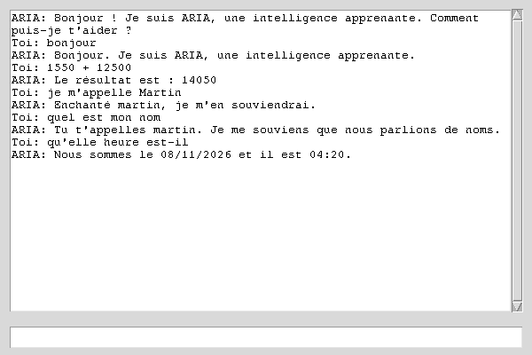

<p align="center">
  
</p>

# ARIA · Local Learnable Intelligence

ARIA is a **symbolic, adaptive AI** · version **1.2.0**: a declarative
skill catalog, an intent router with proof, a rule engine, a disciplined
memory and a security self-audit · no LLM, no machine learning model, no
cloud. It learns exclusively from the conversations you have with it and
runs **100% on your machine**.

[](https://github.com/Mr-Jacks0n/IA/actions/workflows/python-package.yml)
[](LICENSE)


> 🇫🇷 Une version française de ce README est disponible :
> **[README.fr.md](README.fr.md)**

## ✨ Features

- **Declarative skill catalog** · every skill is a `skills/<name>/SKILL.md`
  folder with frontmatter (`name · description · risk · command ·
  triggers`): declaring it is enough to make it routable, the catalog
  validates consistency and lists invalid declarations.
- **Intent router with proof** · skills, logic and learned rules are all
  candidate routes with a confidence score; only the winner runs (lazy)
  and the choice is traceable
  (`[route: … · risk: … · confidence: … · source: …]`).
- **IF/THEN rule learning** · answers are matched against learned rules;
  every unknown input is a teaching opportunity (`Réponse correcte ?` →
  new rule written to disk). Feedback only applies to learned rules: no
  misleading duplicates.
- **Memory discipline** · secrets are never stored (filter on BOTH fact
  and rule writes, explicit refusal), hygiene bounds (200 facts · 500
  rules), every erasure request ("oublie …") is honored without hidden
  copies, session compaction with topic archives.
- **Output masking** · any sensitive value that would be returned is
  masked line by line (defense in depth).
- **Security self-audit** · `python main.py --audit`: six offline phases
  (surface survey → guided hunt → reproducible validation →
  `data/findings.json` → independent re-read → neutral report) chasing
  secrets in `data/` and dangerous calls.
- **Persistent memory** · rules, facts, experiences and context are plain
  JSON files in `data/`, readable and editable by hand.
- **Fuzzy understanding** · `difflib.get_close_matches` maps typos and
  variants to known rules ("qu'elle heure" → "quelle heure est-il").
- **Automatic calculations** · detects expressions anywhere in the input
  ("1550 + 12500" → `Le résultat est : 14050`) through a **safe AST
  evaluator** (no raw `eval`, bounded exponents · see changelog).
- **Fact-based reasoning** · statements ("je m'appelle Martin") are stored
  as facts and later recalled ("quel est mon nom" → "Tu t'appelles martin.").
- **Web search** · "recherche python" triggers a real DuckDuckGo Instant
  Answer query over `requests` (the only network dependency).
- **Reflection** · a short-term memory of the last exchanges gives ARIA
  self-observations: it flags unknown answers, notices repeated topics,
  asks follow-up questions.
- **Special commands** · time/date, open browser, session report, web
  search (skill mapping `CMD:*` handled by `core/skills.py`).
- **Two interfaces** · console (works without tkinter) and Tkinter GUI.
- **Diagnostic modes** · `--debug` (decision trace, fuzzy matches, facts),
  `--stats` (memory state + catalog summary), `--audit` (security
  self-audit).

## 🖼 What it looks like

Real Tkinter window, captured during a genuine session · the "1550 + 12500"
calculation and the remembered name are live answers:

<p align="center">
  
</p>

## 🚀 Getting started

```bash
git clone https://github.com/Mr-Jacks0n/IA.git
cd IA
python -m venv .venv && source .venv/bin/activate
pip install -r requirements.txt        # requests is the only dependency

python main.py          # console mode
python main.py --gui    # graphical mode (needs python3-tk)
python main.py --debug  # console + decision logs
python main.py --stats  # memory state + catalog summary
python main.py --audit  # security self-audit (report data/findings.json)
python utils/clean_data.py   # lowercase-normalize saved rules
```

Console works on servers with no tkinter installed; `--gui` prints
an actionable install hint (`sudo apt install python3-tk`) if Tk is absent.

## 🗂 Project structure

```
.
├── main.py                    # entry point: console | --gui | --debug | --audit | --stats
├── config.py                  # DEBUG_MODE + debug_print helper
├── skills/                    # declarative skills (SKILL.md frontmatter)
│   ├── annonce-date/
│   ├── calculatrice-sure/
│   ├── recherche-web/
│   └── rapport-session/
├── core/
│   ├── decision_engine.py     # pipeline: winning route → execution → verification
│   ├── router.py              # candidate routes, scores, routing proof
│   ├── catalog.py             # frontmatter parser + validation + secret guard
│   ├── rules.py               # DEFAULT_RULES (seed rules)
│   ├── memory.py              # disciplined JSON memory (rules/facts/context)
│   ├── reflection.py          # short-term memory + self-observations
│   ├── selfaudit.py           # security self-audit (6 phases, offline)
│   └── skills.py              # date, calculator (AST-safe), web search, browser, report
├── interface/
│   ├── console.py             # REPL + oui/non feedback loop (clean EOF)
│   └── gui.py                 # Tkinter chat window
├── learning/feedback.py       # learn(rule) → Memory.add_rule (MemoryRefused on secrets)
├── utils/clean_data.py        # normalize saved rule keys
├── data/*.json                # persistent state (defaults shipped)
├── docs/                      # banner + real GUI screenshot
└── .github/                   # CI + issue/PR templates
```

## 🧪 Quality & CI

Every push runs a **3-version CI (Python 3.10 → 3.12)** that:

1. lints the codebase (flake8 `E9/F63/F7/F82`, blocking),
2. runs a **scripted console session** (greet → teach confirmation →
   calculation → name memorization → recall → date command → clean exit)
   and asserts the exact expected answers,
3. runs the **security self-audit** (`python main.py --audit`) and
   validates `data/findings.json` (confirmed/rejected fields),
4. launches ARIA from an unrelated working directory to guarantee the
   data paths are anchored to the project root,
5. fails if any `__pycache__/*.pyc` sneaks back into the index.

## 📜 Version history

- **1.0.0** · rule engine, fuzzy matching, persistent memory, feedback
  learning, facts, reflection, web search, GUI.
- **1.1.0** · reliability pass: fixed the reflection engine comparing an
  exchange with itself, the web-search routing that never fired, an
  `eval()` DoS in the calculator, the hard tkinter dependency, and
  CWD-relative data paths.
- **1.2.0** · move to a declarative architecture: skill catalog
  (`skills/*/SKILL.md`), intent router with proof, memory discipline
  (no secrets ever, bounds, honored erasure), output masking and a
  security self-audit (`--audit`), `--stats` command, hardened console
  and GUI. See [CHANGELOG.md](CHANGELOG.md).

## 🗺 Roadmap

- [ ] Richer fact schemas (age, city, preferences) + follow-up reasoning
- [ ] Multi-shot learning: keep several candidate answers per rule
- [ ] Accent/diacritics normalization before fuzzy matching
- [ ] Export/import of a memory as shareable "knowledge pack"
- [ ] `critical`-risk skills: explicit confirmation before execution
- [ ] Voice input via `speech_recognition` (optional extra)

## 🤝 Contributing

Issues and PRs are welcome · see [CONTRIBUTING.md](CONTRIBUTING.md).
Templates are provided for bugs, ideas and pull requests.

## ⚖️ License

[MIT](LICENSE) · © 2026 Mr Jackson.
